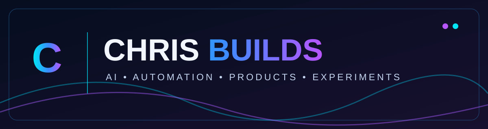

### Founder · AI Builder · Vibe Coding · Learning in Public

**Building useful things with AI, curiosity, and persistence.**

[Zenova Wellness](https://zenovawellness.me) · [Tool Research Hub](https://toolhunter.freebuff.app) · [GitHub Projects](https://github.com/hcochrisg-spec?tab=repositories)

---

## Hey, I'm Chris

I'm an entrepreneur, Army veteran, and self-taught builder exploring how AI can help turn ideas into working products. I learn by building—from ecommerce and automation to personal AI assistants and interactive experiments.

**My approach:** Start with a real problem. Build a small version. Test it. Improve it.

## The build desk

| Project | Focus | Explore |
| --- | --- | --- |
| **Zenova Wellness** | Wellness ecommerce and connected digital experiences | [Website](https://zenovawellness.me) |
| **Tool Research Hub** | Discovering and organizing tools for builders | [Website](https://toolhunter.freebuff.app) |
| **Vibe** | Social media app experiment | [Public repository](https://github.com/hcochrisg-spec/Vibe) |

## In the lab

- **SOURCE AI** — Personal AI assistant and desktop interaction experiments.
- **Botverse** — Exploring interactive 3D experiences and AI agents.
- **Automation and creator tools** — Turning ideas into repeatable workflows.

*Some projects are private or works in progress. This profile does not imply that their source code is publicly available.*

## What I work with

`AI assistants` · `Automation` · `Vibe coding` · `Ecommerce` · `Product design` · `3D experiences`

## Follow the builds

Browse [my public GitHub projects](https://github.com/hcochrisg-spec?tab=repositories). Building in public where it makes sense, keeping private work private.
